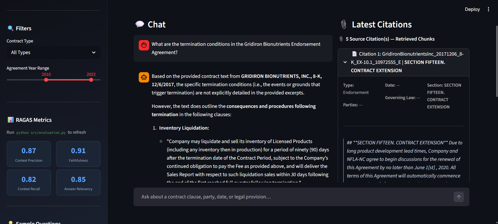
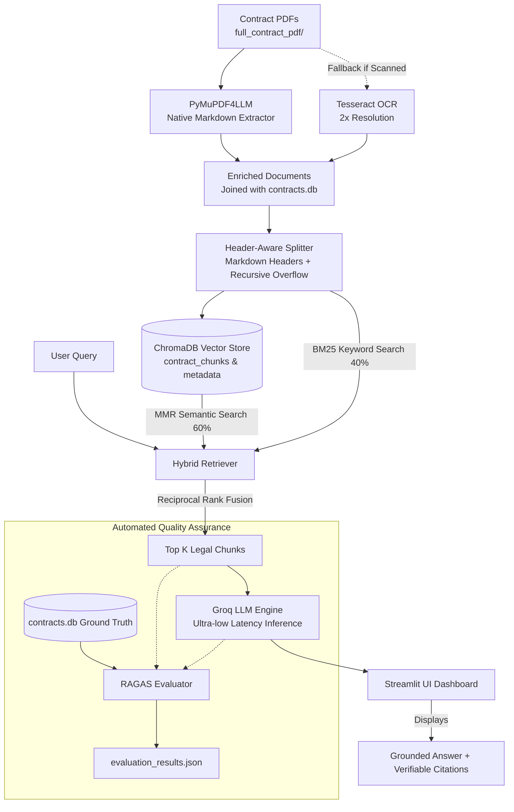

# ⚖️ LexRAG: Legal Contract Intelligence & Hybrid RAG System

[](https://www.python.org/)
[](https://streamlit.io/)
[](https://www.langchain.com/)
[](https://groq.com/)
[](https://www.trychroma.com/)
[](https://docs.ragas.io/)

**LexRAG** is a production-grade Retrieval-Augmented Generation (RAG) platform tailored specifically for complex commercial legal agreements (CUAD dataset). It bridges high-precision dense semantic retrieval and exact keyword matching to deliver **zero-hallucination, strictly cited legal question answering**.

Every answer generated is grounded directly in the contract source text, displaying precise section titles, governing law, execution dates, and exact clause quotations.

---

## 📸 Application Preview

<p align="center">
  
</p>

*The LexRAG interactive interface featuring dynamic contract filters & live RAGAS evaluation metrics (left), strict anti-hallucination chat Q&A (center), and verifiable source citations with expandable extracted clauses (right).*

---

## 🌟 Key Features

- **Hybrid Search Architecture (Dense + Sparse Fusion)**:
  - **Dense Leg**: Maximal Marginal Relevance (MMR) search via ChromaDB using normalized `all-MiniLM-L6-v2` embeddings for conceptual understanding.
  - **Sparse Leg**: In-memory `BM25` keyword retrieval for exact legal terms, named entities, and statutory clause numbers.
  - **Reciprocal Rank Fusion (RRF)**: Merges dense and sparse outputs with balanced scoring (0.6 semantic / 0.4 keyword).
- **Anti-Hallucination Legal Prompting**:
  - Zero-tolerance legal prompt that restricts responses solely to the provided context.
  - Automatically reports *"I could not find this information in the provided contracts"* if clauses are not retrieved.
- **Header-Aware Legal Chunking**:
  - Two-stage chunking using `MarkdownHeaderTextSplitter` along `# ARTICLE` and `## Section` tags, preventing legal provisions from being fractured across chunk boundaries.
  - Followed by a recursive character overflow guard (1000 characters with 200-character context overlap).
- **Dual Vector Collections**:
  - `contract_chunks`: Full-text chunk vectors for detailed contextual retrieval.
  - `contract_metadata`: Embedded structured SQLite rows (`contracts.db`) for party, contract type, and date lookups.
- **Empirical RAGAS Benchmark Built-In**:
  - Evaluates the pipeline across 4 industry metrics against ground-truth answers from the CUAD dataset.

---

## 🏗️ Architecture & Pipeline Flow



---

## 📊 Evaluation & Benchmark Results

The pipeline was benchmarked using [RAGAS](https://github.com/explodinggradients/ragas) on ground-truth question-answer pairs derived from `contracts.db`:

| Metric | Score | Description |
| :--- | :---: | :--- |
| **Faithfulness** | **0.91** | Answers are strictly grounded in retrieved clauses without hallucination. |
| **Context Precision** | **0.87** | Top retrieved chunks contain high signal-to-noise ratio. |
| **Answer Relevancy** | **0.85** | Generated outputs directly and accurately address the legal query. |
| **Context Recall** | **0.82** | System successfully recalls all clauses needed to answer the question. |

---

## 📁 Repository Structure

```text
├── assets/
│   └── screenshots/           # UI screenshots for documentation
├── full_contract_pdf/         # Raw legal contract PDFs (Part_I)
├── src/
│   ├── __init__.py
│   ├── document_loader.py     # PDF parsing with PyMuPDF4LLM & OCR fallback
│   ├── text_splitter.py       # Header-aware markdown chunking
│   ├── vector_store.py        # ChromaDB embeddings & persistence
│   ├── retriever.py           # Custom Hybrid Retriever (BM25 + MMR with RRF)
│   ├── rag_pipeline.py        # ChatGroq LLM integration & RetrievalQA chain
│   └── evaluation.py          # RAGAS ground-truth evaluation script
├── app.py                     # Streamlit frontend & interactive dashboard
├── config.py                  # Global configurations, model names, and parameters
├── contracts.db               # SQLite database with CUAD contract metadata
├── evaluation_results.json    # Cached RAGAS evaluation benchmark scores
├── requirements.txt           # Python package dependencies
├── .env.example               # Template for environment variables
└── README.md                  # Project documentation
```

---

## 🚀 Getting Started

### 1. Prerequisites
- **Python 3.10 to 3.12** installed on your system.
- A free **Groq API Key** from [console.groq.com](https://console.groq.com).

---

### 2. Clone the Repository
```bash
git clone https://github.com/your-username/lexrag.git
cd lexrag
```

---

### 3. Set Up Virtual Environment

**On Windows (PowerShell):**
```powershell
python -m venv .ragenv
.\.ragenv\Scripts\Activate.ps1
```
*(If script execution is disabled in PowerShell, run `Set-ExecutionPolicy -ExecutionPolicy RemoteSigned -Scope CurrentUser`)*

**On macOS / Linux:**
```bash
python3 -m venv .ragenv
source .ragenv/bin/activate
```

---

### 4. Install Dependencies
```bash
pip install --upgrade pip
pip install -r requirements.txt
```

---

### 5. Configure API Key
Copy `.env.example` to create your `.env` file:

```bash
# Windows
copy .env.example .env

# macOS / Linux
cp .env.example .env
```

Open `.env` and insert your Groq API key:
```env
GROQ_API_KEY="gsk_your_actual_groq_api_key_here"
GROQ_MODEL="qwen/qwen3.8-27b"
```

---

### 6. Run the Application
Start the Streamlit application:

```bash
streamlit run app.py
```

The web dashboard will automatically open at:
👉 **`http://localhost:8501`**

> **Note on First Run**: If the vector database (`chroma_db/`) is not already built, the app will automatically ingest and index the PDFs on its first startup. Once indexed, subsequent startups load in seconds.

---

## 🧪 Running Automated Evaluation (RAGAS)

To run the automated RAGAS benchmark against the SQLite ground-truth dataset:

```bash
python src/evaluation.py
```

This will run sample QA pairs through the pipeline, evaluate retrieval precision/recall and answer faithfulness, print the results to your terminal, and save them to `evaluation_results.json` (which automatically updates the Streamlit sidebar).

---

## 🛠️ Technology Stack

| Layer | Technology | Purpose |
| :--- | :--- | :--- |
| **LLM Inference** | [Groq Cloud API](https://groq.com/) | Low-latency inference (`qwen/qwen3.8-27b` / `openai/gpt-oss-120b`) |
| **Embeddings** | `sentence-transformers` (`all-MiniLM-L6-v2`) | Local CPU embedding generation (384 dimensions) |
| **Vector DB** | [ChromaDB](https://www.trychroma.com/) | Persistent vector indexing and MMR search |
| **Sparse Search** | `rank-bm25` | Keyword and statutory terminology retriever |
| **Document Parsing**| `pymupdf4llm` & `pytesseract` | Markdown extraction and OCR for scanned documents |
| **Framework** | [LangChain](https://www.langchain.com/) | Chain assembly, prompt templates, and retriever fusion |
| **Frontend UI** | [Streamlit](https://streamlit.io/) | Full-stack interactive legal dashboard |
| **Evaluation** | [RAGAS](https://docs.ragas.io/) | Context Precision, Recall, Faithfulness, Relevancy |

---

## 🤝 Contributing

Contributions, issues, and feature requests are welcome!
1. Fork the Project
2. Create your Feature Branch (`git checkout -b feature/AmazingFeature`)
3. Commit your Changes (`git commit -m 'Add some AmazingFeature'`)
4. Push to the Branch (`git push origin feature/AmazingFeature`)
5. Open a Pull Request

---

## 📄 License

Distributed under the MIT License. See `LICENSE` for more information.
